# Mem0 OSS 多语言支持设计方案（统一双向量）

> 适用版本：本仓库 v2.2.1（V3 管线）。文中行号已对照当前代码核实。
> 本文件是设计文档（.md），不是 Mintlify 发布页；实施时用户向文档另建 .mdx 并同步 docs.json / llms.txt。

> dense  ：密集；
> sparse ：稀疏；
> learned sparse：学习型稀疏

> **前提**（本方案仅在以下前提下成立）：
> - **P-A**：嵌入模型一次前向同时输出 dense + 学习型稀疏（如 BGE-M3 系，任何同能力模型可替换）。
> - **P-B**：向量库原生存储与检索两种向量（如 Qdrant 命名稀疏槽、pgvector ≥0.7.0 sparsevec）。
>
> **核心思路**：一个双输出模型 + 一个双能力库——一次前向、一次写入、三路检索（语义 / 词汇 / 实体）。语言识别与检索元数据交给抽取 LLM，payload 是元数据的单一事实来源，实体库是可重建的派生索引。融合与守卫逻辑全部在应用层；模型与库都是可替换的参考实现。

---

## 1. 目的与前提

### 1.1 要解决的问题

| # | 问题 | 现状根因 |
|---|------|----------|
| P1 | 中文对话可能被抽取成英文记忆 | 语言指令钩子 `use_input_language` 存在但未接线（`prompts.py:1026`、`main.py:950/2635`） |
| P2 | 中文查询的关键词检索路失效 | `Qdrant/bm25` 英文词项编码，中文无分词 |
| P3 | 中文记忆的实体加分失效 | spaCy `en_core_web_sm` 硬编码 + 大小写启发式；update 重链同样依赖 spaCy（`main.py:714`），中文记忆一经更新实体链接即丢失 |
| P4 | 跨语言召回质量一般 | 默认 `text-embedding-3-small` 多语言能力非最优 |
| P5 | 混合打分对中文结构性失效 | sigmoid 长度分桶按空格计数（`scoring.py:29`），中文查询永远落入同一桶 |
| P6 | 换嵌入模型后既有阈值含义漂移 | search 语义门槛默认 0.1（`main.py:1642-1645`、`scoring.py:111`）按旧模型相似度分布调定；实体匹配 0.95/0.5 同理。属对现有用户的行为变更，须显式管理 |

### 1.2 前提与核实

| # | 前提 | 参考实现 | 核实方式 |
|---|------|----------|----------|
| P-A | 模型一次前向双输出 dense + 学习型稀疏 | BGE-M3 系（可替换） | 模型卡 + 双输出实测 |
| P-B | 向量库原生双向量存储与检索 | Qdrant；pgvector ≥0.7.0 | 适配器能力实测（6.2/6.3） |

前提把稀疏路的边际成本压到≈0：模型为稠密已加载，稀疏是同一次前向的副产品；库的稀疏槽位免费。因此稀疏路直接作为基线上线，质量风险（精确 token）由探针验收承接（第 8 章 S5）。

### 1.3 目标与非目标

| 类别 | 内容 |
|------|------|
| 目标 | 记忆以输入语言入库；中/英/混合查询均可召回；关键词路与实体路对中文生效；数据不出域 |
| 目标 | 模型中立、向量库中立：机制只依赖接口契约（2.3），参考实现可整体替换 |
| 目标 | 写入无损：去重/折叠不丢弃事实更新类记忆 |
| 目标 | 英文场景不回退：默认配置下提示词、词形还原、打分路径逐字节不变 |
| 目标 | 零 per-部署标定：阈值与归一化参数按模型登记于 ModelProfile，评测一次产出、随版本发布 |
| 非目标 | 不改变 V3 ADD-only 管线结构；不做语言检测路由；不引入图数据库；不改哈希去重逻辑 |
| 非目标 | 查询侧不新增 LLM 调用；**不含存量数据迁移**（面向新建 collection） |
| 非目标 | 公共 API 仅一处有界扩展：`insert`/`keyword_search` 增加可选稀疏向量参数（3.4），向后兼容 |

---

## 2. 总体流程

本章以统一视图给出实施前后架构：2.1 写入流程、2.2 检索流程（各为独立小节，三色标注前后节点），2.3 组件契约，2.4 逐维对比，2.5 决策机制。

**三色标注约定（适用于本章所有流程图）：绿色 = 新增，蓝色 = 修改，红色 = 删除。** 节点不做背景填充，仅文字与边框着色；删除节点另用虚线边框。

| 标注 | 含义 |
|------|------|
| 绿色（文字/边框） | 新增：仅实施后存在 |
| 蓝色（文字/边框） | 修改：前后均存在、实现变更（标签内注明"前→后"） |
| 红色（文字/边框，虚线） | 删除：仅实施前存在，对比示意；部分仅在特定配置下删除，遗留路径保留 |
| 无色 | 不变 |
| 实线 / 虚线 | 实施后流程 / 实施前路径 |

### 2.1 写入流程（前后统一视图）

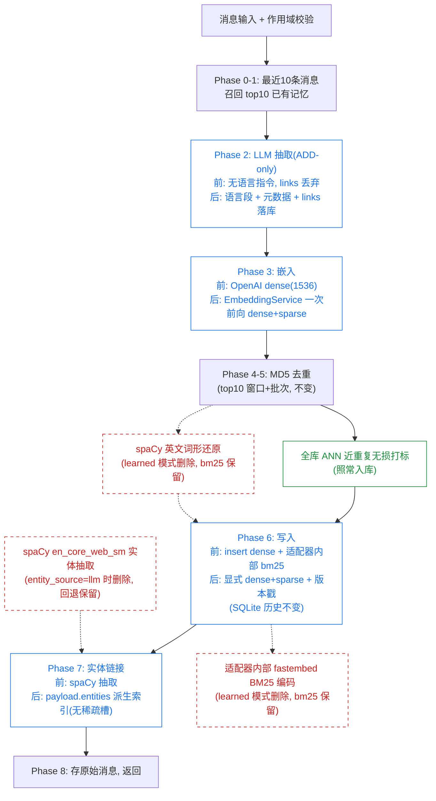

写入侧删除条件：spaCy 词形还原与适配器内部 BM25 编码仅在 `sparse_encoder=learned` 时删除（bm25 遗留逐字节保留）；spaCy 实体抽取仅在 `entity_source=llm` 时删除（校验回退保留）。

### 2.2 检索流程（前后统一视图）

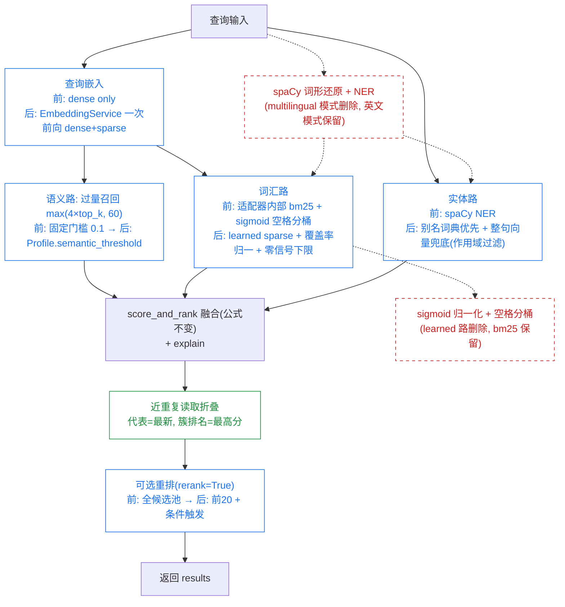

检索侧删除条件：查询侧 spaCy 仅在 `multilingual=on` 时删除（英文模式保留）；sigmoid 空格分桶仅在 learned 路删除（bm25 保留）。UPDATE/DELETE 仍仅显式 API、过期隐藏不变（2.5）。

### 2.3 组件契约

机制只依赖以下契约，不依赖任何具体模型/库/服务框架：

| 契约 | 内容 | 参考实现（可替换） |
|------|------|--------------------|
| EmbeddingService | 批量文本 → `{dense: [[float]], sparse: [{indices, values}], model_id, revision}`，一次调用双输出 | 远程 HTTP 批量服务（TEI、薄 FastAPI 封装、vLLM 等）为一等路径；进程内封装本地模型为开发兜底 |
| VectorStore 适配器 | dense 检索、payload 读写、按作用域 list、update；声明 `supports_sparse_vectors` 能力；稀疏槽/列细节各自封装 | qdrant（6.2）、pgvector（6.3）；其余 provider 无稀疏能力时词汇路自动缺席（分母自适应） |
| ModelProfile | 按 model_id 登记阈值与归一化参数（7.2） | 评测一次产出、随版本发布的默认值表 + 配置覆盖 |
| Reranker | 既有 `rerank(query, documents, top_k)` 抽象（5 个 provider） | 任意多语言 cross-encoder |

### 2.4 实施前后对比

| 维度 | 实施前 | 实施后 |
|------|--------|--------|
| 抽取语言 | 无指令，中文可能被译成英文 | 语言段 + lang 留痕（3.1） |
| 抽取输出 | text/attributed_to/links（links 丢弃） | + lang/entities+aliases/keywords，links 落库（2.5） |
| 稠密嵌入 | OpenAI API，仅 dense，1536 | 双输出模型/服务，dense+sparse 一次前向（3.2） |
| 稀疏编码 | fastembed BM25，适配器内部，英文中心 | learned sparse 显式传入；lexical 槽/sparsevec 列，无 IDF（6.2/6.3） |
| 稀疏归一化 | sigmoid + 空格分桶（中文失效） | 覆盖率归一 + 零信号下限（4.2） |
| 语义门槛 | 固定 0.1 | ModelProfile 按模型登记（7.2） |
| 实体来源 | spaCy en（中文无效，update 丢链接） | LLM 实体+别名（entity_source 可选）；update 词典+兜底重链（4.3/5.1） |
| 查询侧实体 | spaCy NER | 别名词典优先 + 向量兜底（4.3） |
| 去重 | MD5 窗口 + LLM 判重 | + 全库 ANN 无损打标 + 读取折叠（3.3/4.5） |
| 实体库 | 带稀疏槽（死重） | 派生索引，无稀疏，可从 payload 重建（3.5） |
| 版本管理 | 无戳，向量空间可误混 | 三戳 + 启动校验拒写（6.4） |
| 重排 | 可选、全池 | 前 20 + 条件触发（4.6） |
| 决策机制 | ADD-only，链接丢弃 | ADD-only 不变，链接落库 + 打标 + 折叠（2.5） |
| 模型/DB 耦合 | OpenAI + Qdrant 事实绑定 | 契约化，参考实现可替换（2.3 契约表） |

### 2.5 记忆决策机制（实施前后）

**总纲：决策骨架前后不变，变更共 6 处。** V3 是 ADD-only，LLM 没有 UPDATE/DELETE 决策权——这一点实施前后不变（1.3 非目标）。6 个变更点：抽取决策（L）、近重复判定（N，新增）、重复命中处置（T，新增）、写入落库（W）、读取侧折叠（R，新增）、update 重链（U2）；下文差异表与流程图着色节点**按节点 ID 一一对应**。

#### 不变的骨架（已核实）

| 决策 | 机制 | 位置 |
|------|------|------|
| ADD-only | 提示词 "Your sole operation is ADD"；历史/返回事件一律 ADD | `prompts.py:472`；`main.py:1084/:1210` |
| 矛盾走链接、不走 UPDATE | 同实体/偏好更新/叙事延续/矛盾一律输出 linked_memory_ids | `prompts.py:692-701` |
| UPDATE/DELETE 仅显式 API | update()/delete()；历史 UPDATE/DELETE 事件仅产生于此 | `main.py:1829/:1883/:2100/:2132`（异步 `:3822/:3856`） |
| MD5 精确去重 | 命中 top10 窗口 + 当前批次 → 跳过 | `main.py:1022-1025` |
| 抽取/跳过规则 | LLM 按提示词判定：跳过回声、响应内去重、Recently Extracted 为主参照、语义等价且无新上下文 → 跳过、存疑则抽取 | `prompts.py:503/:511/:578/:682/:683` |
| 过期隐藏 | search/get_all 默认隐藏，非删除 | `main.py:1684` |


#### 改动后决策整体流程

三色标注约定见章首：绿 = 新增（N/T/R），蓝 = 修改（L/W/U2），无色 = 不变骨架；着色节点共 6 个，与下方差异表一一对应。

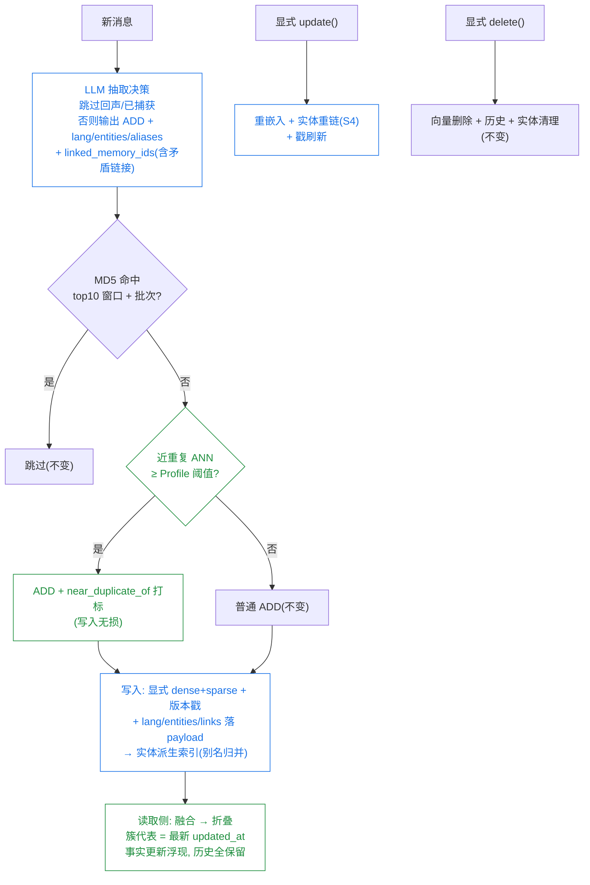

#### 实施前后差异

6 个变更点，与流程图着色节点一一对应（字母为节点 ID）：

| # | 决策点（节点） | 实施前 | 实施后 |
|---|--------------|--------|--------|
| 1 | 抽取决策（L） | 无语言指令，中文可能译英；输出仅 text/attributed_to，**links 输出但被丢弃**（无消费点，`:1031-1039/:1209-1212`） | 语言段决定同语言记录；输出 + lang/entities+aliases/keywords + links（含矛盾链接）（3.1） |
| 2 | 近重复判定（N，新增） | 无（语义判重仅靠 LLM，翻译对/改写易漏） | 全库 top-1 ANN，≥ Profile 阈值进入打标分支（3.3） |
| 3 | 重复命中处置（T，新增） | 语义重复无处置（MD5 跳过属不变骨架） | **打标不跳过**（near_duplicate_of，写入无损）（3.3） |
| 4 | 写入落库（W） | insert dense + 适配器内部 bm25；payload 无元数据/无戳；实体库 spaCy 来源、带稀疏槽 | 显式 dense+sparse + 版本戳；**lang/entities/links 落 payload**；实体派生索引（无稀疏槽）（3.4/3.5/6.4） |
| 5 | 读取侧呈现（R，新增） | 无折叠，新旧并存可能同返、挤占 top_k | 折叠代表 = 最新 updated_at，事实更新浮现；历史全保留（4.5） |
| 6 | update 重链（U2） | spaCy 重链（中文记忆必丢链接） | 词典 + 向量兜底重链 + 戳刷新（5.1） |

MD5 跳过、普通 ADD 事件、delete 清理、过期隐藏均不变（见骨架表与流程图无色节点）。


#### 边界与澄清

- **为什么不引入 LLM 决策的 UPDATE/DELETE**：就地更新不可逆、丢历史；ADD + 链接 + 无损打标 + 读取折叠 = "呈现最新、保留全部历史"（SQLite 可审计），与无损原则（3.3）一致。矛盾检测本就是 LLM 的链接职责（`prompts.py:699`），链接落库后才真正可用。
- **legacy 残留（不在现行决策路径）**：`DEFAULT_UPDATE_MEMORY_PROMPT`（`prompts.py:176`，ADD/UPDATE/DELETE/NONE）与 `get_update_memory_messages`（`:406`）全仓库零调用；add() docstring "decide whether to add, update, or delete"（`:790-792`）为 legacy 措辞，与实现不符。
- **命名区分**：记忆级 `payload.linked_memory_ids`（记忆→记忆，新落库）≠ 实体库同名字段（实体→记忆列表，现有，用于加分 `main.py:1811-1822`）。

---

## 3. 写入管线（add）

本章与第 4 章均描述**实施后的目标态流程**（目标配置组合见 7.1）；前后对比统一见第 2 章，遗留模式（bm25 / spacy）差异仅在各节以表行注明。

实施后全流程（括号内为细节小节）：

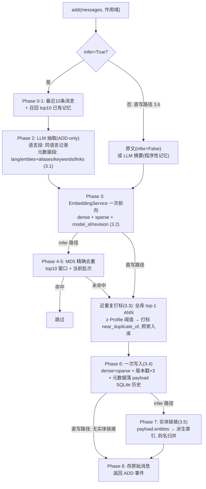

### 3.1 语言感知抽取与检索元数据（Phase 2）

**提示词注入**（`multilingual=True` 时生效；系统提示词 `prompts.py:918-943` 不动，开关关闭时提示词逐字节不变）：

| 注入段 | 内容 | 来源 |
|--------|------|------|
| 语言段 | LLM 完成语言识别与同语言记录，不引入语言检测器 | 复用已有 CJK 规则段（`prompts.py:1047-1059`） |
| 元数据段 | 每条记忆顺带输出 lang / entities+aliases / keywords | 构建器 `generate_additive_extraction_prompt`（`prompts.py:1016`）新增 `include_metadata` 参数 |

接线点：同步 `main.py:950`、异步 `main.py:2635`，传 `use_input_language` 与 `include_metadata`。

**抽取输出**：

```
memory[i] = {
  id, text, attributed_to, linked_memory_ids,
  lang: "zh",                                        // BCP-47 短码, 几乎零 token
  entities: [{surface: "苹果公司", aliases: ["Apple", "苹果"], type: "org"}],
  keywords: ["iPhone 16 Pro 256G"]                   // 可选, 规范化编号/双语关键词
}
```

**字段消费点**：

| 字段 | 落库 | 用途 |
|------|------|------|
| lang | payload | 按语言过滤、混合语分析、评测分桶、重排触发判断（4.6） |
| entities + aliases | payload（单一事实来源） | 实体派生索引（3.5）；跨语言同一实体靠**别名精确匹配**归并，不靠余弦阈值猜 |
| keywords | payload | 规范化编号 / 双语关键词 |
| linked_memory_ids | payload（现状被丢弃，实施后落库） | 矛盾/偏好更新链接，事实演化可追溯（2.5） |

**校验与回退**（实体失败不阻断入库，`main.py:1203-1204`）：

| 检查项 | 处理 |
|--------|------|
| text 非空、type 在枚举内 | 非法 type 归 PROPER |
| 类型映射 | person/org/location/brand/work → PROPER；topic/concept → TOPIC；identifier → IDENTIFIER |
| 实体去重 | 按 `_normalize_entity_text`（`main.py:583`） |
| 某条记忆缺失/非法 | 该条回退 spaCy |
| `entity_source="spacy"` | 全走 spaCy（遗留路径） |

### 3.2 一次前向双向量（Phase 3）

| 项 | 内容 |
|----|------|
| 调用点 | 批量编码 `main.py:993-1005`、异步 `:2679` |
| 契约 | 批量文本 → `{dense, sparse, model_id, revision}`，一次调用双输出（2.3） |
| 接入模式 | 远程 HTTP 批量服务为一等路径（模型进程不随 API worker 扩容）；进程内实现仅供开发/单机 |
| 供应链 | 数据不出域：权重固定 revision/哈希、支持离线本地路径加载，禁止运行时从公网拉取 |

### 3.3 去重与近重复打标（无损）

三道防线，按执行顺序：

| # | 防线 | 比对范围 | 命中处置 | 位置 |
|---|------|----------|----------|------|
| 1 | LLM 语义判重 | Phase 2 对照 Existing Memories | 跳过抽取 | 现有机制 |
| 2 | MD5 精确去重 | top10 召回记忆 + 当前批次（非全库） | 跳过入库 | `main.py:1009-1013/1022`、异步 `:2690-2703` |
| 3 | 近重复 ANN 打标（新增） | 全库 top-1 ANN，作用域过滤 | **照常入库** + payload 打标 `near_duplicate_of` + 相似度 | 标准 `vector_store.search`，复用 Phase 3 向量，毫秒级零重嵌 |

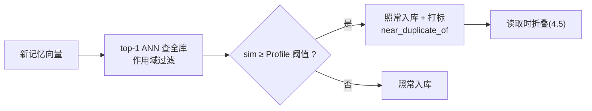

| 设计要点 | 说明 |
|----------|------|
| 为什么打标不跳过 | 稠密余弦对否定/数字/实体替换不敏感（"喜欢咖啡"/"不再喝咖啡"相似度很高），跳过会不可逆丢失事实更新；写入永远无损，重复在读取时折叠（4.5） |
| 阈值 | `Profile.near_duplicate_threshold`，按模型以翻译对/否定对/数字替换对专项测定 |
| 边界 | 打标覆盖全库，但受 ANN 召回质量限制，不承诺绝对去重 |

### 3.4 写入与版本戳（Phase 6）

一次写入（`main.py:1057-1059`、异步 `:2738-2743`），写入内容清单：

| 写入项 | 内容 | 来源 |
|--------|------|------|
| dense 向量 | Phase 3 输出 | 3.2 |
| sparse 向量 | Memory 层经 `insert` 的**可选** `sparse_vectors` 参数显式传入；仅在适配器 `supports_sparse_vectors=True` 时传入 | 3.2 / 6.2 / 6.3 |
| 检索元数据 | lang / entities / keywords / linked_memory_ids | 3.1 / 6.1 |
| 版本戳×3 | embedder_id / sparse_encoder_id / schema_version | 6.4 |
| 近重复标记 | near_duplicate_of + 相似度（命中时） | 3.3 |
| text_lemmatized | learned 模式存**原文**（跳过英文词形还原） | 本节 |
| SQLite 历史 | ADD 事件，不变 | 现有 |

兼容性：`insert` 可选参数向后兼容，旧调用方与非稀疏适配器不受影响（公共 API 变更须同步 docs）；`sparse_encoder="bm25"` 遗留模式保留适配器内部编码与原词形还原逻辑，逐字节不变。

### 3.5 实体派生索引（Phase 7）

payload.entities 是单一事实来源；实体库是可从 payload 全量重建的派生索引（重建零 LLM 调用）。

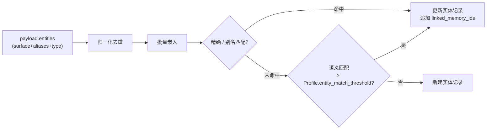

| 属性 | 内容 |
|------|------|
| 记录 schema | `{data: surface, aliases, entity_type, linked_memory_ids, scope}` |
| 链接流程 | 复用 Phase 7（`main.py:1100-1103`、异步 `:2785-2788`） |
| 语义匹配阈值 | 入 Profile（现 0.95，`main.py:1166`）；跨语言同一实体靠别名归并 |
| 稀疏槽 | **不建**：全仓库无任何 `entity_store.keyword_search` 调用，稀疏纯属死重；关掉省一次前向、简化建表 |
| 配置 | 与主库同 provider、deepcopy 主库配置（`main.py:559-580`），派生配置中关闭稀疏 |

### 3.6 直写路径（infer=False / 程序性记忆）

两条绕过 V3 抽取的直写分支，机制适用性：

| 路径 | 流程 | 适用机制 | 不适用 |
|------|------|----------|--------|
| `infer=False`（`main.py:882-916`） | 逐条原文嵌入（`:904`）→ `_create_memory`（`:1975`，异步 `:3673`）直写 | 文本预处理（3.4）、版本戳（6.4）、近重复打标（3.3） | LLM 抽取、哈希去重检查、实体链接（保持现状；需要实体覆盖走 `infer=True` 或后续 update） |
| 程序性记忆（`main.py:855-864` → `_create_procedural_memory :2007`） | LLM 生成摘要 → `_create_memory` 直写 | 同上 | 同上 |

`_create_memory` 计算 hash 但不做去重检查（`main.py:1984`），现状行为，不在本方案更改范围。

---

## 4. 检索管线（search）

实施后全流程（括号内为细节小节）：

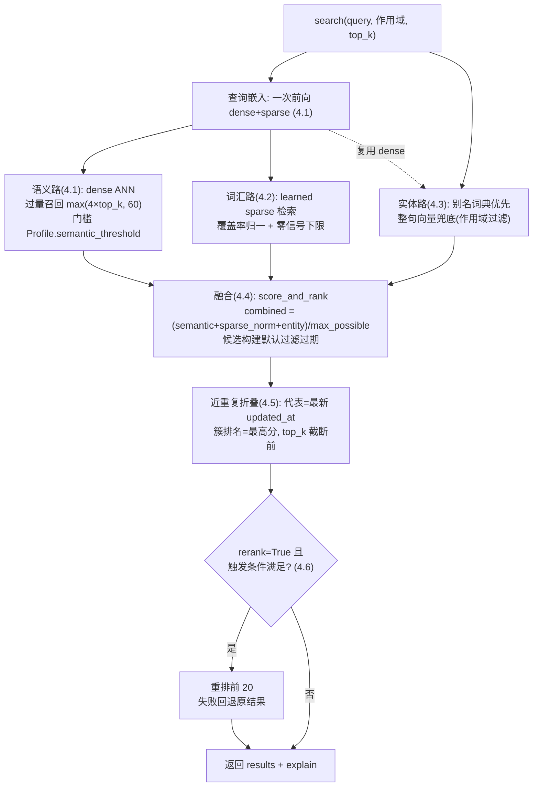

### 4.1 查询嵌入与语义路

| 步骤 | 操作 | 参数 / 位置 |
|------|------|-------------|
| 查询嵌入 | EmbeddingService 一次前向取 dense + sparse，三路共用 | `main.py:1652`、异步 `:3341` |
| 过量召回 | dense ANN 召回 `max(4×top_k, 60)` 候选 | `main.py:1655` |
| 语义门槛 | `Profile.semantic_threshold` 过滤候选，先于融合执行 | 门槛执行 `scoring.py:111`；接线 `main.py:1642-1645`、异步 `:3333-3334` |

换模型必须换 Profile 条目并重评（P6），阈值不跨模型沿用。

### 4.2 词汇路

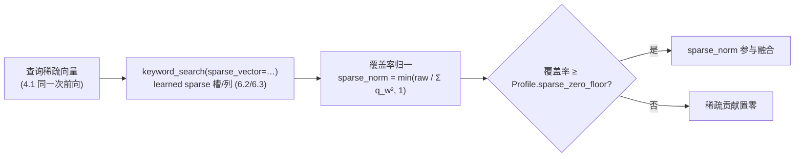

| 设计点 | 内容 |
|--------|------|
| 归一化分母 | 查询稀疏向量自得分 `Σ(q_w²)`，应用层计算；绝对、有界、免标定，保留"无命中≈零分"的质量信号 |
| 零信号下限 | 覆盖率 < `Profile.sparse_zero_floor` → 置零，跨语言空信号/弱命中不凭空给分 |
| 不用 max 归一化 | 它使每查询 top 命中恒为 1.0，放大噪声 |
| 无长度分桶 | 归一化与查询长度无关（P5 消除） |
| 路缺席 | 无稀疏能力的适配器 → 词汇路自动缺席，融合分母自适应（4.4） |
| 遗留模式 | `sparse_encoder="bm25"`：原 sigmoid 与分桶逐字节不变（`scoring.py:16-54`） |

### 4.3 实体路（两层）

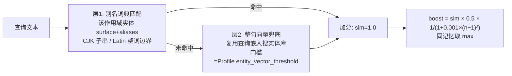

| 层 | 机制 | 成本与阈值 |
|----|------|------------|
| 层1 别名词典 | 按作用域加载 surface+aliases（`entity_store.list(filters, top_k=10000)`，`main.py:589`）；常驻缓存、实体写入时失效（TTL 兜底）；CJK 子串 / Latin 整词边界（防 Apple/Pineapple 误配），规模大再上 Aho-Corasick（可选依赖） | 精确、语言无关、无阈值；命中 sim=1.0 |
| 层2 向量兜底 | 复用已算好的查询嵌入搜实体库 | 零额外编码、零 LLM；门槛 `Profile.entity_vector_threshold`（按模型测定，不沿用 0.5 初值） |

| 约束 | 内容 |
|------|------|
| 作用域过滤强制 | 两层均保持 user/agent/run 过滤（`main.py:1770/1788-1790`、异步 `:3447-3473`），配多租户测试 |
| 加分公式 | 复用现有实现（`main.py:1807-1822`）：`boost = sim × 0.5 × 1/(1+0.001×(n−1)²)`，同记忆取 max，上限 0.5 |
| 遗留模式 | `entity_source="spacy"` 且 `multilingual=False`：原 spaCy 路径逐字节不变 |

### 4.4 融合

`score_and_rank`（`scoring.py:60-139`）公式、分母自适应、explain 分项全部不变：

```
combined = (semantic + sparse_norm + entity) / max_possible
```

| 规则 | 行为 |
|------|------|
| 门槛次序 | 语义门槛（4.1）先于融合 |
| 分母自适应 | 词汇路缺席 → max_possible 自动退化（现有机制原样保留） |
| 过期过滤 | 候选构建默认隐藏过期记忆（`_payload_is_expired`，`main.py:1682-1691`、异步 `:3370-3380`）；`show_expired=True` 可显示 |
| expiration_date | 随 payload 存储，结果中提升为顶层字段（`main.py:1704-1712`） |

### 4.5 近重复读取折叠

结果格式化阶段（`main.py:1703-1719`、异步对应处）按 `near_duplicate_of` 聚簇：

| 规则 | 内容 |
|------|------|
| 簇代表 | 取 **updated_at 最新**一条，确保"不再喝咖啡"类事实更新浮现，不被高分旧记忆压住 |
| 簇排名 | 取簇内最高分 |
| 时机 | top_k 截断前折叠，重复不挤占名额 |
| 可观测 | explain 输出簇信息 |
| 开关 | 折叠策略可配置关闭 |

### 4.6 重排

显式开启（`rerank=True`，默认 False，`main.py:1400/1514`）之上叠加触发条件与范围约束：

| 项 | 内容 |
|----|------|
| 触发条件（可配） | 查询语言与候选主语言不一致（用 payload.lang 判断，零成本）或语义分偏低 |
| 重排范围 | **只重排前 20**（调用点截断，`main.py:1516`、异步 `:3205`） |
| 失败处理 | 非致命，回退原结果（`:1518-1519`） |
| provider | 中立：既有 5 个 reranker provider 任选多语言 cross-encoder，纯配置 |

---

## 5. 更新与删除

本章描述实施后的目标态流程。UPDATE/DELETE 决策权仍仅在显式 API（2.5），LLM 无此权限。

实施后全流程（括号内为细节小节）：

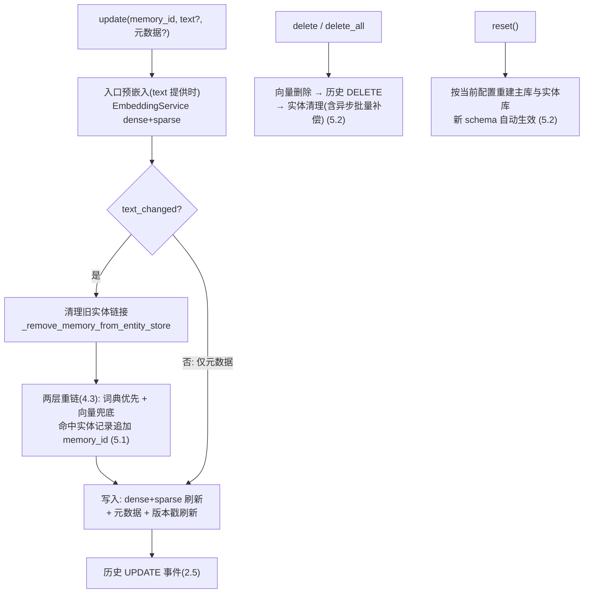

### 5.1 update 实体重链

关键操作，按执行顺序（重链主体 `_link_entities_for_memory`，`main.py:707-728`、异步 `:2408-2425`；调用点 `:2110-2112`/`:3834`）：

| # | 操作 | 内容 | 位置 |
|---|------|------|------|
| 1 | 入口预嵌入 | text 提供时先算 dense+sparse，传入 `_update_memory` 复用 | `main.py:1876-1877`、异步 `:3556-3558` |
| 2 | 前置清理 | 文本变更时先清理旧实体链接（不变） | `_remove_memory_from_entity_store`，`main.py:652` |
| 3 | 两层重链 | 新文本走 4.3 词典优先 + 向量兜底 | `_link_entities_for_memory` |
| 4 | 追加链接 | 命中实体记录直接追加 memory_id，实体不重嵌 | `update(vector=None)` payload-only 分支，`qdrant.py:551-564` |
| 5 | 向量与 payload 刷新 | 文本变更经 EmbeddingService 重算 dense+sparse；元数据与版本戳刷新；适配器 update 全量分支同步刷新稀疏 | 6.2 |

两条路径的行为差异：

| 路径 | 实体清理/重链 | 向量与 payload | 位置 |
|------|----------------|----------------|------|
| 文本变更（text_changed=True） | 触发（上表步骤 2–4） | dense+sparse + 元数据 + 版本戳刷新 | 上表 |
| 仅元数据（text=None） | 不触发 | 向量与 payload 仍刷新，版本戳与元数据字段同样更新 | `main.py:2066-2091`、异步 `_update_memory :3772` |

| 边界 | 说明 |
|------|------|
| 不创建新实体 | 该路径无 NER/LLM；更新文本引入的新实体待下次 add 或索引重建入库 |
| 底线 | 不丢已有链接（P3：中文记忆 update 不再静默丢失实体链接） |

### 5.2 delete / delete_all / reset

| 路径 | 流程 | 位置 |
|------|------|------|
| 单条删除 | 向量删除 → 历史 DELETE（is_deleted=1）→ 实体清理 `_remove_memory_from_entity_store`（非致命） | `_delete_memory`，`main.py:2116-2144`、异步 `:3838-3867` |
| 批量删除（同步） | 逐条走 `_delete_memory` | `main.py:1947-1948` |
| 批量删除（异步） | 跳过逐条实体清理（`skip_entity_cleanup=True`），批次完成后 `_bulk_clear_entity_store(filters)` 统一补偿 | `:3631`、`:3641-3642` |
| reset() | 按当前配置重建主库与实体库，新 schema（lexical 槽/sparsevec 列、无稀疏实体库）自动生效 | `main.py:2146-2176`、异步 `:3869-3900` |

与近重复/派生索引机制的交互：

| 项 | 行为 |
|----|------|
| 近重复打标 | 随记忆删除自然失效 |
| 读取折叠 | 聚簇按存量 payload 字段工作（4.5） |
| 异步批量补偿 | 派生索引模型下批量路径天然一致（3.5） |

---

## 6. 存储层

本章描述实施后的目标态存储结构与适配器行为（目标配置 `sparse_encoder=learned`，7.1）；遗留 bm25 差异以表行注明。

实施后存储总览：

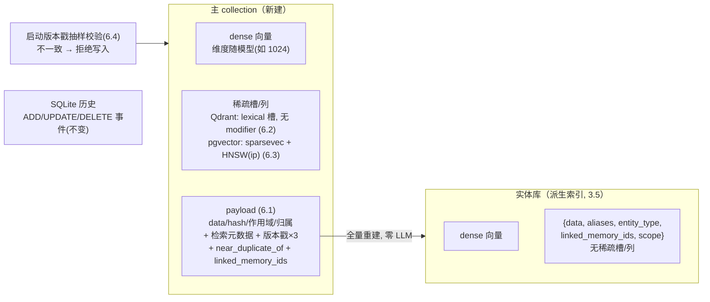

### 6.1 payload schema（单一事实来源）

| 字段 | 来源 | 说明 |
|------|------|------|
| data / hash / created_at / updated_at | 现有 | 不变 |
| user_id / agent_id / run_id | 现有 | 会话作用域键，不变 |
| actor_id / attributed_to / role | 现有 | 归属字段：actor_id 供查询过滤（`main.py:319/337-339`），存储侧由消息内容导出，非会话作用域键 |
| lang / entities / keywords | 3.1 | 检索元数据；实体库由此重建 |
| embedder_id / sparse_encoder_id / schema_version | 6.4 | 向量空间版本戳 |
| near_duplicate_of / near_duplicate_similarity | 3.3 | 无损打标 |
| text_lemmatized | 3.4 | learned 模式存原文；bm25 模式原逻辑 |
| linked_memory_ids | 2.5/3.1 | 记忆→记忆关联（LLM 输出，落库）；区别于实体库同名字段（实体→记忆列表） |
| expiration_date | 现有（可选） | 过期记忆默认隐藏（4.4），结果中提升为顶层字段 |

### 6.2 Qdrant 适配器

**稀疏槽定义**：新槽 `lexical`，`SparseVectorParams()` **不带 modifier**——学习型稀疏权重已学习好，再叠 IDF 等于双重加权（对照：bm25 槽带 `Modifier.IDF` 补语料统计，`qdrant.py:174-178`）。

活动槽全链路（`sparse_encoder=learned` 时各环节统一指向 lexical 槽）：

| 环节 | 位置 | 行为 |
|------|------|------|
| 编码器与槽属性初始化 | `qdrant.py:95-108` | 按 sparse_encoder 选择活动槽 |
| 建表 | `:145-181` | 创建 lexical 槽（无 modifier） |
| 槽检测 | `:161` | 检测活动槽存在性（词汇路缺席判断的依据，4.4） |
| insert | `:218` | 写入 Memory 层显式传入的稀疏向量 |
| keyword_search | `:471` | 用查询稀疏向量检索活动槽 |
| update 全量分支 | `:530-539` | 槽名同步切换（现硬编码 bm25 槽名）；**文本变更必须走此分支** |
| update payload-only 分支 | `:559-561` | 不刷新稀疏（仅追加链接等 payload 操作，5.1） |

配置与能力：

| 项 | 内容 |
|----|------|
| `sparse_encoder` | `"bm25" \| "learned"`，默认 bm25，遗留路径逐字节不变 |
| 能力位 | `supports_sparse_vectors=True`；insert/keyword_search 接受可选稀疏向量参数 |
| 实体库 | 派生配置不建稀疏槽（3.5） |

### 6.3 pgvector 适配器

词汇路走 `sparsevec` 列（pgvector ≥0.7.0），不用 PostgreSQL 全文检索——`to_tsvector('simple')` 不分词不词形还原，中文整段成一个 token（现路径 `pgvector.py:389-391`、GIN 索引 `:304`，由 sparsevec 分支取代）。

工作项：

| 项 | 内容 |
|----|------|
| 类型/列 | `sparsevec` 列（pgvector ≥0.7.0） |
| 写入路 | 建表 `_ensure_collection`（`:216`/CREATE TABLE `:271`）加列与索引；insert（`:311-329`）加稀疏列写入；update（`:416`）同步刷新稀疏列 |
| 索引 | HNSW `sparsevec_ip_ops`（内积） |
| 查询 | `<#>` 算子返回负内积，适配器转正 |
| **1000 非零上限** | sparsevec 上限 1000 个非零元素；15–80 词记忆短句（`prompts.py:934`）安全；长输入与长查询须"保留 top-1000 权重"截断，规则进适配器单测 |
| 能力位 | `supports_sparse_vectors=True`；接受可选稀疏向量参数 |

能力事实来源：pgvector 官方 README/CHANGELOG（0.7.0 新增 sparsevec 及索引；≤1000 非零元素；L2/内积/余弦）：https://github.com/pgvector/pgvector 。

### 6.4 版本戳与启动校验

三戳随写入路径落 payload（3.4；写入点 `main.py:1031-1039` 及 create/update 对应处）：

| 戳 | 值 |
|----|----|
| embedder_id | provider:model@revision |
| sparse_encoder_id | 稀疏编码方式标识 |
| schema_version | payload schema 版本 |

启动校验（`Memory.__init__ :488`、`AsyncMemory.__init__ :2196`）：

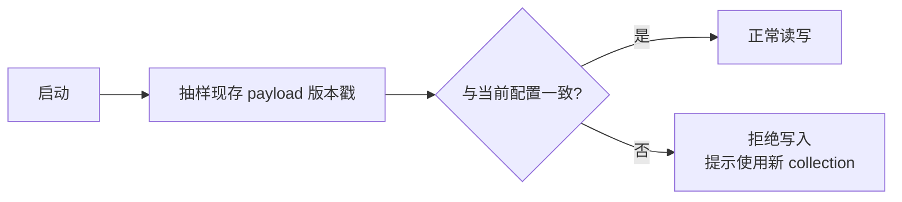

| 要点 | 说明 |
|------|------|
| 目的 | 杜绝不同向量空间误混（换模型/换稀疏编码后旧向量不可比） |
| 存量数据 | 迁移不在本方案范围（1.3），面向新建 collection |

---

## 7. 配置

### 7.1 配置轴

| 配置项 | 控制 | 默认 |
|--------|------|------|
| `multilingual` | 提示词语言段 + lang 留痕；预设把 `entity_source` 置 llm、推荐开启 near_duplicate | False |
| `entity_source: "spacy"\|"llm"` | 入库/update 实体来源（独立于语言，LLM 实体对英文同样有收益） | spacy |
| `near_duplicate: bool` | 无损打标 + 读取折叠（独立） | False |
| `vector_store.config.sparse_encoder` | 词汇路：`"learned"` 双输出稀疏；`"bm25"` 遗留 | bm25 |
| `embedder.provider` + ModelProfile | 稠密引擎 + 全套阈值 | openai + 现值 profile |

非回退保证按轴：`multilingual=off` → 提示词逐字节不变；`sparse_encoder=bm25` → 词形还原与 sigmoid 逐字节不变；`entity_source=spacy` → 实体路逐字节不变。目标态组合：`multilingual=on + entity_source=llm + sparse_encoder=learned + near_duplicate=on`。

连接与覆盖入口：EmbeddingService 的接入模式（进程内 / 远程端点）在 `embedder.config` 配置（如 `service_url`），远程为一等路径（2.3）；ModelProfile 的配置覆盖入口为 `MemoryConfig.profiles`（可选，缺省用随版本发布的默认值表）。

### 7.2 ModelProfile

按 model_id 登记，**评测一次测定、随版本发布**（非 per-部署标定），配置可覆盖：

| 字段 | 用途 | 现状参照 |
|------|------|----------|
| `semantic_threshold` | 语义门槛（P6） | 0.1 |
| `entity_match_threshold` | 入库实体语义匹配 | 0.95 |
| `entity_vector_threshold` | 查询→实体向量兜底门槛 | 0.5 |
| `near_duplicate_threshold` | 近重复打标 | 新增，翻译对/否定对专项测定 |
| `sparse_zero_floor` | 覆盖率零信号下限 | 新增，无命中/弱命中查询测定 |

换模型 = 换 Profile 条目 + 新 collection 重嵌；阈值含义漂移（P6）被显式管理并进评测（第 8 章 S0/S2）。

### 7.3 配置示例

```python
from mem0 import Memory

config = {
    "multilingual": True,
    "entity_source": "llm",
    "near_duplicate": True,
    "embedder": {                          # 双输出模型, 经 EmbeddingService 接入
        "provider": "<双输出模型 provider>",
        "config": {"model": "<如 BGE-M3>", "embedding_dims": 1024,
                   "service_url": "<嵌入服务端点>"},   # 远程一等; 进程内兜底可省略
    },
    "vector_store": {
        "provider": "qdrant",              # 或 pgvector(6.3 分支)
        "config": {
            "collection_name": "mem0_ml",  # 新建 collection
            "embedding_model_dims": 1024,
            "sparse_encoder": "learned",
            "path": "/data/qdrant",
        },
    },
    "llm": {"provider": "openai", "config": {
        "model": "<中文能力强的模型, 如 Qwen 系>",
        "openai_base_url": "<自建网关>/v1"}},
    "reranker": {                          # 可选: 任意多语言 cross-encoder
        "provider": "sentence_transformer",
        "config": {"model": "<多语言重排模型>"}},
}
m = Memory.from_config(config)
```

---

## 8. 实施阶段

**划分原则**：每一步可独立交付（功能默认关闭或配置门控，可单独上线）、可独立评测（跑 S0 评测设施，验收见表）。**每步不变量**：默认配置下提示词/词形还原/打分代码路径逐字节不变；换模型类步骤以英文集数值对比为验收。重改造按适配器拆分，可并行。

### 8.1 依赖与并行

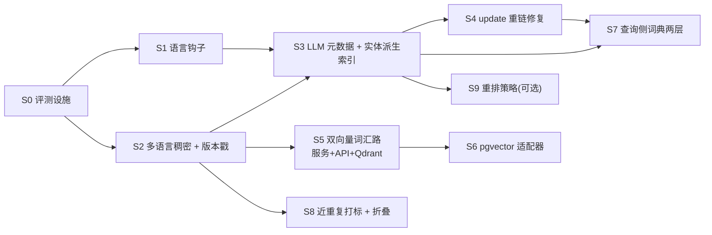

箭头为推荐前序（硬依赖见表）。推荐发布顺序 S0→S1→S2→S3→S4→S5→S7；S6/S8 可按资源并行插入，S9 最后。

### 8.2 步骤与验收

| 步 | 交付内容（代码点） | 独立验收 | 依赖 |
|----|--------------------|----------|------|
| S0 评测设施 | 评测集 + 基线运行 + explain 分路统计工具；**无产品代码改动** | 设施可复现基线；各用例类基线成绩留档 | 无 |
| S1 语言钩子 | `multilingual` 配置 + 提示词接线（`main.py:950/2635`），复用现有语言段；零向量/schema 改动 | 中文对话入库为中文、事实完整；**提示词 diff 测试：关闭时逐字节一致**；英文集不回退 | 硬：无；评测：S0 |
| S2 多语言稠密 + 版本戳 | embedder 配置切换（既有 provider）+ 新 collection；payload 三戳 + 启动校验（`:488/:2196`）；Profile 稠密条目（semantic_threshold 等）随模型测定 | 跨语言召回达绝对目标；英文数值对比不回退；戳不一致拒写 | 硬：无（纯配置+新 collection）；评测：S0 |
| S3 LLM 元数据 + 实体派生索引 | include_metadata 注入段；lang/entities+aliases/keywords/linked_memory_ids → payload（链接现被丢弃，新落库）；实体库 aliases + 无稀疏槽 + 重建入口；entity_source 选项 + Phase 7 切换（`:1100-1103/:2785-2788`） | 中文记忆带实体/别名；矛盾/更新链接可查；实体库可从 payload 全量重建（零 LLM）；抽取质量对比开关前不降；英文实体不回退 | 硬：无；推荐：S1+S2 |
| S4 update 重链修复 | `_link_entities_for_memory`（`:707-728/:2408-2425`）向量兜底分支：新文本嵌入→实体库检索→追加链接；仅元数据路径戳刷新 | 中文记忆 update 后链接保持；否定类更新不丢；英文 update 不回退 | 硬：S3（兜底 helper 供 S7 复用） |
| S5 双向量词汇路 | EmbeddingService + 双输出 provider 注册（`factory.py:152`）；insert/keyword_search 可选参数 + 能力位（`base.py:11/:72`）；Qdrant lexical 槽无 modifier 全链路含 update（`:95-128/:145-181/:218/:471/:518-549`）；覆盖率归一 + 零信号下限；词形还原跳过；Profile 稀疏条目 | 中文精确名词命中词汇路；无命中/弱命中查询稀疏零分；延迟预算达标；**bm25 遗留路径逐字节不变**；可选参数向后兼容 | 硬：S2（P-A 统一模型前提） |
| S6 pgvector 适配器 | sparsevec 列 + HNSW(ip) + <#> 分支 + insert/update 写入（`:216-310/:311-329/:369-414/:416`）+ top-1000 截断 | S5 同款词汇路验收在 pgvector 上跑通；截断/符号单测通过 | 硬：S5（服务+API 参数）；可与 S5 收尾并行 |
| S7 查询侧词典两层 | 词典缓存 + 失效钩子（`:605/:1193-1200/:2292`）；查询侧切换词典优先 + 兜底（S4 helper）；作用域过滤保持（`:1770`） | 中文实体查询获加分；多租户隔离测试；别名误配率（Apple/Pineapple 类）达标 | 硬：S3+S4 |
| S8 近重复打标 + 折叠 | 全部写入路径（含 3.6 直写）top-1 ANN 打标；读取折叠（代表=最新）；near_duplicate 开关；Profile 阈值 | 翻译对被折叠、不挤占 top_k；否定/数字对不误折叠；折叠可关 | 硬：无（任意稠密可用）；推荐：S2；可并行 |
| S9 重排策略（可选） | 前 20 截断 + 条件触发（lang 不一致/语义分低，`:1514-1519/:3205`），保持 rerank=True 显式开启 | 跨语言召回提升与延迟代价留档；不触发时行为与现状一致 | 硬：S3（lang 字段） |

### 8.3 每步回滚

- **配置门控步**（S1 / S3 的 entity_source / S8 / S9）：开关切回即恢复现状。
- **向量空间步**（S2 / S5 / S6）：embedder / sparse_encoder 配置切回旧值，旧 collection 未动、数据完整；新 collection 上切回 bm25 时词汇路因无 bm25 槽自动缺席（槽检测现有机制），语义+实体正常。新 collection 数据不自动回迁（迁移不在范围，1.3）。
- **代码步**：按附录清单回退；各步改动集中于独立文件/段，跨步无纠缠。

---

## 9. 附录：改动点清单（同步 + 异步 + update 全覆盖）

| # | 文件 | 位置 | 改动 | 步骤 |
|---|------|------|------|------|
| 1 | `configs/base.py` | :29 | multilingual（S1）/ entity_source（S3）/ near_duplicate（S8） | S1/S3/S8 |
| 2 | `configs/prompts.py` | :1016；语言段 :1047-1059 不动 | 语言段接线（S1）；include_metadata 注入段（lang/entities+aliases/keywords）+ 中文示例（S3） | S1/S3 |
| 3 | `memory/main.py` | :950、:2635 | 接线 use_input_language（S1）+ include_metadata（S3） | S1/S3 |
| 4 | `utils/model_profiles.py` | 新增 | Profile 默认值表 + 覆盖；稠密条目 S2 测定、稀疏条目 S5 测定 | S0/S2/S5 |
| 5 | `memory/main.py` | :1031-1039、:2712-2720、create/update 对应处 | payload：版本戳三字段（S2）+ lang/entities/keywords/linked_memory_ids（S3，链接现被丢弃，新落库） | S2/S3 |
| 6 | `memory/main.py` | Memory.__init__ :488、AsyncMemory.__init__ :2196 | 版本戳抽样校验，不一致拒写 | S2 |
| 7 | `memory/main.py` | :1100-1103、:2785-2788 | Phase 7 按 entity_source 切换 + 校验回退 | S3 |
| 8 | `memory/main.py` | :559-580、Phase 7 写入段 | 实体库派生化：aliases 字段、无稀疏槽、重建入口 | S3 |
| 9 | `utils/embedding_service.py` | 新增 | 服务契约：远程/进程内，批量 dense+sparse，revision 上报 | S5 |
| 10 | `configs/vector_stores/qdrant.py` + `configs/vector_stores/pgvector.py` | 两者均 :6（QdrantConfig / PGVectorConfig） | sparse_encoder 字段（bm25/learned），两个配置类同步新增 | S5/S6 |
| 11 | `vector_stores/base.py` + qdrant/pgvector | base.py :11（insert）/:72（keyword_search）；各适配器 | 可选 sparse_vectors/sparse_vector 参数 + supports_sparse_vectors 能力位（docs 同步） | S5 |
| 12 | `vector_stores/qdrant.py` | :95-128、:145-181、:218、:471、:518-549 | lexical 槽无 modifier、活动槽全链路（初始化/建表/检测/insert/update/查询）、能力位 | S5 |
| 13 | `vector_stores/pgvector.py` | :216-310（建表/索引）、:311-329（insert）、:369-414（查询）、:416（update） | sparsevec 列 + HNSW(ip) + <#> 查询分支 + top-1000 截断 + insert/update 稀疏写入/刷新 | S6 |
| 14 | `memory/main.py` | :1028/1988/2078/2709/3687/3798；查询 :1648/3337 | 文本预处理 helper：learned 存原文，bm25 原逻辑 | S5 |
| 15 | `utils/scoring.py` | 新增函数；:16-54 保留 | 覆盖率归一 + 零信号下限 | S5 |
| 16 | `memory/main.py` | :1665-1673、:3354-3362；门槛 :1642-1645/:3333-3334 | 语义门槛接 Profile（S2）；归一化分发（S5） | S2/S5 |
| 17 | `memory/main.py` | Phase 5 后 :1017-1041/:2698-2722；直写路径 :882-916/:1975/:3673；格式化 :1703-1719/async | 近重复 ANN 打标（全部写入路径，含 3.6 直写）+ 读取折叠 | S8 |
| 18 | `utils/entity_dictionary.py` + `memory/main.py` | 新增；失效钩子 :605/:1193-1200/:2292 | 作用域词典缓存 + CJK/Latin 匹配 + 实体写入失效 | S7 |
| 19 | `memory/main.py` | :1649/1676-1678、:3338/3364-3367；加分 :1747/:3435 | 向量兜底 helper（S4）；查询侧切换词典优先 + 兜底，作用域过滤保持（S7） | S4/S7 |
| 20 | `memory/main.py` | :707-728、:2408-2425 | update 重链：向量兜底（S4）；词典增强（S7） | S4/S7 |
| 21 | `memory/main.py` | :1514-1519、:3205 | reranker 前 20 截断 + 条件触发（lang 判断），保持 rerank=True 显式开启 | S9 |
| 22 | `tests/` + `docs/` | 新增 | 各机制 mock 单测（截断、符号、多租户、否定对、向后兼容）+ 英文回归；用户向 .mdx + docs.json + llms.txt | 各步 |
| 23 | `embeddings/<双输出 provider>.py` + `utils/factory.py` + `configs/embeddings/base.py` | 新增 + :152 注册 | EmbeddingService 的 EmbeddingBase 封装（dense 视图）+ factory 注册 + 服务连接参数（service_url 等） | S5 |
